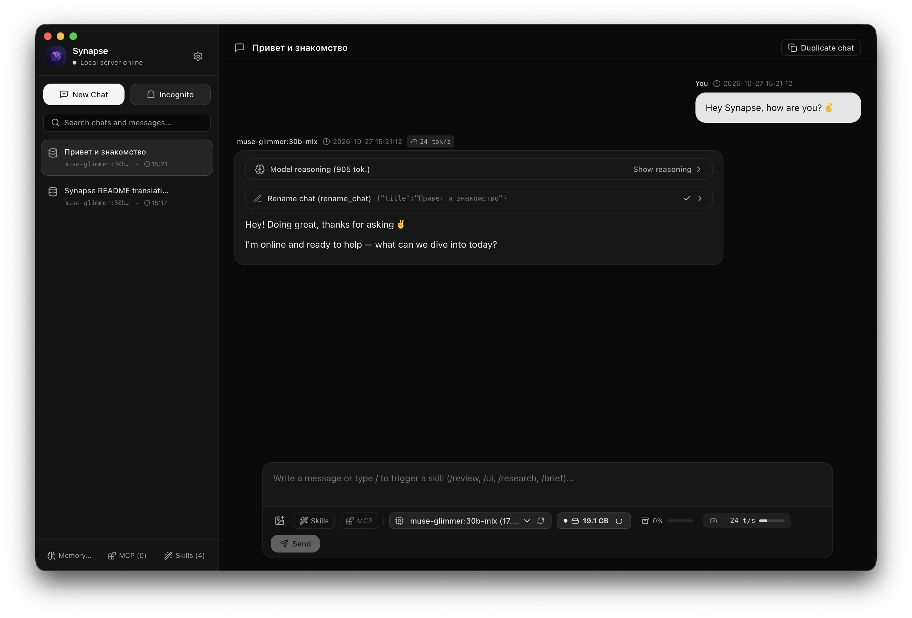

# Synapse

**Synapse** (*Synapse by zemskov.space*) is a local-first desktop AI workspace built with **Electron, React, TypeScript, and Tailwind CSS**. It connects seamlessly to local **[Ollama](https://ollama.com/)** models as well as any external **OpenAI-compatible AI provider** (DeepSeek, OpenAI, OpenRouter, Groq, LM Studio, vLLM, and more), featuring a calm, distraction-free light and dark interface.



---

## Key Features

- **Local Ollama + External OpenAI-Compatible Providers**:
  - Run 100% private local models via **Ollama** (`/api/chat`, `/api/tags`, `/api/ps`, `/api/show`) with real-time RAM/VRAM residency indicators and one-click model load/unload controls.
  - Connect unlimited external **OpenAI-compatible APIs** (DeepSeek, OpenAI, OpenRouter, Groq, xAI, local vLLM/LM Studio) with automatic model discovery (`/v1/models`) or custom model IDs, selectable per chat right from the composer bar.
- **Smart Context Window Compression**:
  - Automatically inspects the active model's context length and tracks token usage in real time.
  - When conversation history exceeds your configured threshold (default `72%`), older messages are automatically summarized into a compact `compressedSummary` while preserving the most recent turns verbatim.
- **Persistent Global Memory & True RAM-Only Incognito Mode**:
  - **SQLite Storage (`sql.js` WASM)**: All chats, messages, global user memories, MCP servers, skills, providers, and settings are stored locally in `~/Library/Application Support/space.zemskov.synapse/synapse_local.sqlite` (macOS) or the platform-equivalent userData folder.
  - **Incognito Chats (RAM-Only)**: Incognito conversations live strictly in main-process volatile memory (`Map`), never touch the disk, and are permanently wiped when closed. Incognito chats have read-only access to global memory and cannot add, modify, or delete memory records.
- **Built-in Tools, Web Search & MCP Server Integration**:
  - **Function Calling**: Built-in tools for automatic chat naming (`rename_chat`), long-term user memory management (`memory_add`, `memory_update`, `memory_delete`), and direct keyless web access (`web_search`, `fetch_web_page`).
  - **Model Context Protocol (MCP)**: Connect external `stdio` MCP servers (`npx`, `uvx`, Node, Python, Docker, etc.) to expose custom tools directly to your models.
  - **Slash Skills (`/skill-name`)**: Create reusable prompt workflows and trigger them inline with `/` autocomplete in the message composer.
- **Rich Markdown, Code Syntax Highlighting & Interactive HTML Widgets**:
  - Full GitHub Flavored Markdown with language-detected syntax highlighting, header badges, and one-click copy buttons.
  - **Sandboxed HTML Previews (` ```html `)**: Rendered live inside isolated `iframe` containers with automatic height resizing and live CSS theme variables (`--app-bg`, `--app-surface`, `--app-text`, `--app-border`, etc.) that adapt immediately when switching between Light and Dark themes.
  - **Interactive Form Widgets (` ```html-widget `)**: Models can render interactive forms (checkboxes, selects, radio buttons, sliders, text inputs) at the end of a response with a **"Submit response to chat"** button.
- **Thoughtful UX & Productivity Tools**:
  - **First-Run Onboarding Wizard**: Guided setup for interface language (`English` / `Русский`), theme (`Light` / `Dark` / `System`), Ollama host verification, and default model selection.
  - **Chat Branching (Duplication) & Time-Travel Editing**: Duplicate any conversation in one click or edit any past user message to rewind and regenerate the conversation from that point.
  - **Instant Feedback & Desktop Notifications**: Immediate assistant placeholder with model RAM loading status, one-click retry on network/provider errors, animated `<think>` / reasoning blocks, and native OS notifications when background generation completes.

---

## Getting Started

### Prerequisites
- **Node.js** 18+
- **[Ollama](https://ollama.com/)** running locally (default `http://127.0.0.1:11434`) with at least one model pulled (e.g., `ollama pull llama3.2` or `ollama pull qwen2.5`).

### Install Dependencies
```bash
npm install
```
*(If your npm configuration skips postinstall scripts for Electron, run `node node_modules/electron/install.js` once).*

### Run in Development Mode (Hot Reload)
```bash
npm run dev
```

### Build Frontend & Launch Electron
```bash
npm run build:app
npm start
```

### Package Desktop Distributables
```bash
# Build for current platform (macOS .dmg and .zip by default)
npm run build

# Build for macOS, Windows, and Linux
npx electron-builder -mwl
```
Compiled installers and archives are generated in the `release/` directory.

---

## Project Structure

```text
├── assets/
│   ├── icons/                      # App icons for macOS (.icns), Windows (.ico), Linux, and UI
│   └── screenshots/                # Application screenshots for documentation
├── electron/
│   ├── db/                         # Modular SQLite repositories (chats, memories, settings, extensions, devInspector)
│   ├── services/
│   │   ├── chatOrchestrator.ts     # Unified Ollama & OpenAI streaming, tool loops, and notifications
│   │   ├── chatStore.ts            # Unified facade for SQLite persistent chats + RAM incognito chats
│   │   ├── contextCompression.ts   # Smart token estimation and automatic conversation summarization
│   │   ├── ollamaService.ts        # Ollama API helpers, headers, and context window inspection
│   │   ├── openaiService.ts        # OpenAI-compatible provider discovery and chat completions
│   │   ├── promptBuilder.ts        # Localized system prompt assembly, <think> and inline tool parser
│   │   └── webScraper.ts           # Keyless DuckDuckGo search and web page text extraction
│   ├── ipcHandlers.ts              # Electron IPC handler registrations
│   ├── main.ts                     # Electron main process entry point & window lifecycle
│   ├── preload.ts                  # ContextBridge API exposed to the renderer process
│   ├── mcp.ts                      # Model Context Protocol (stdio & HTTP JSON-RPC) client manager
│   └── tools.ts                    # Localized built-in and MCP tool schema definitions and executor
├── src/
│   ├── components/
│   │   ├── chat/                   # ChatHeader, MessageList, and ChatComposer components
│   │   ├── dev/                    # Built-in SQLite table inspector, SQL console, and RAM diagnostics
│   │   ├── onboarding/             # First-run OnboardingModal wizard
│   │   ├── settings/               # Modular settings tabs (General, Memory, MCP, Skills, Providers, Prompt, About)
│   │   ├── HtmlIframeBlock.tsx     # Sandboxed iframe renderer with live theme CSS injection
│   │   ├── MarkdownContent.tsx     # GFM parser, syntax highlighter, and widget extractor
│   │   ├── SettingsModal.tsx       # Settings modal container
│   │   ├── Sidebar.tsx             # Chat list, search, incognito toggle, and quick actions
│   │   ├── ThinkingBlock.tsx       # Expandable reasoning/thinking trace viewer
│   │   └── ToolCallsBlock.tsx      # Function execution status and result inspector
│   ├── i18n/                       # Localization system & localized system prompts (English & Russian)
│   ├── types/                      # Shared TypeScript interfaces
│   ├── utils/                      # Formatters, iframe sandbox template, prompt helpers, syntax highlighter
│   ├── App.tsx                     # Root application state and IPC stream subscriptions
│   └── index.css                   # Tailwind CSS & custom theme utilities
├── LICENSE
├── package.json
├── tsconfig.json
└── vite.config.ts
```

---

## License

Released under the [MIT License](LICENSE). Developed by **[zemskov.space](https://zemskov.space)**.
